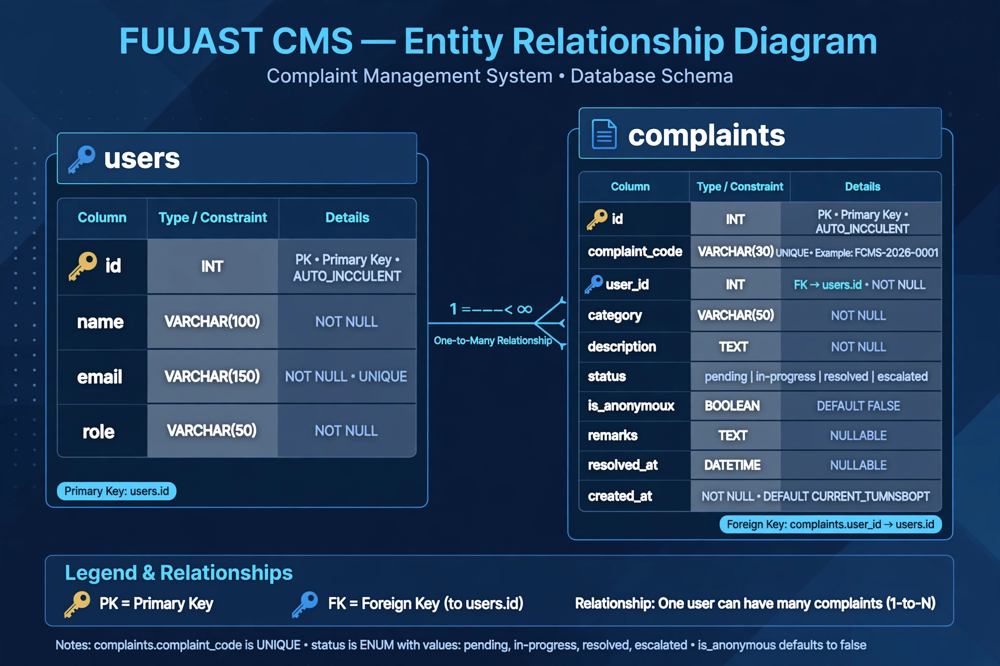

# FUUAST CMS - Complaint Management System
**Final Year Project - Federal Urdu University**

### Student: Aimal Khan Ahmed Khan
### Roll: FUUAST-2022-BSCS-XXX

### Features - Week 1 to Week 8:

**Week 5 - Complaint ID Engine:**
- Auto ID: FCMS-2026-0001, FCMS-2026-0002...
- Anonymous Complaint: 🔒 Yes/No - Student ka naam hide

**Week 6 - Student Module:**
- My Complaints Page: FCMS code ke saath list
- Search: FCMS-2026-0001 se search
- Status Tracking: pending, in-progress, resolved, escalated

**Week 7 - Admin Panel + 72h Auto-Escalation:**
- Admin Panel: /admin/complaints - All complaints
- Status Update: Pending -> In-Progress -> Resolved + Remarks
- 72h Auto-Escalation: `php artisan complaints:escalate` - 72 ghante se zyada pending = auto escalated to HOD
- Command: `app/Console/Commands/EscalateComplaints.php`

**Week 8 - Email Notification + Final:**
- Email: ComplaintStatusMail - FCMS-2026-0001 Resolved pe student ko email
- Log: MAIL_MAILER=log - storage/logs/laravel.log me save
- Gmail: Real email inbox me
- ERD, Deployment, Presentation

### Tech Stack:
Laravel 11, PHP 8.2, SQLite, Blade, PHPMailer

### Setup:
1. git clone https://github.com/aimalkhanbangash11111-design/fuuast-cms
2. cd fuuast-cms
3. composer install
4. copy .env.example .env
5. php artisan key:generate
6. php artisan migrate
7. php artisan serve

### Admin Login:
coordinator@fuuast.edu.pk / 12345678

### GitHub:
https://github.com/aimalkhanbangash11111-design/fuuast-cms
48 Commits - Week 1 to Week 8

### Viva Points:
- FCMS-2026-0001 Auto ID
- Anonymous 🔒
- 72h Escalation: 1 complaints escalated after 72h!
- Email: FCMS Resolved Email in Log + Gmail

